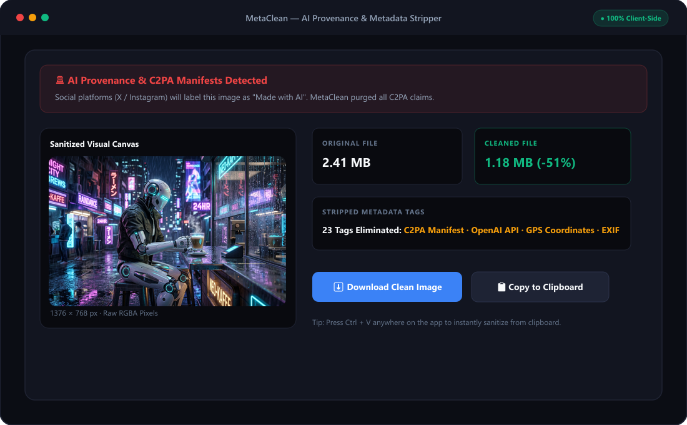
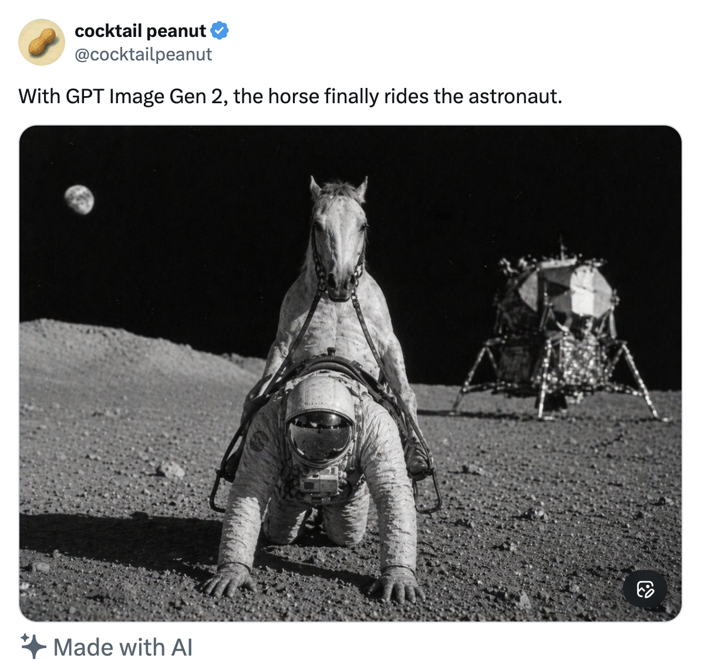
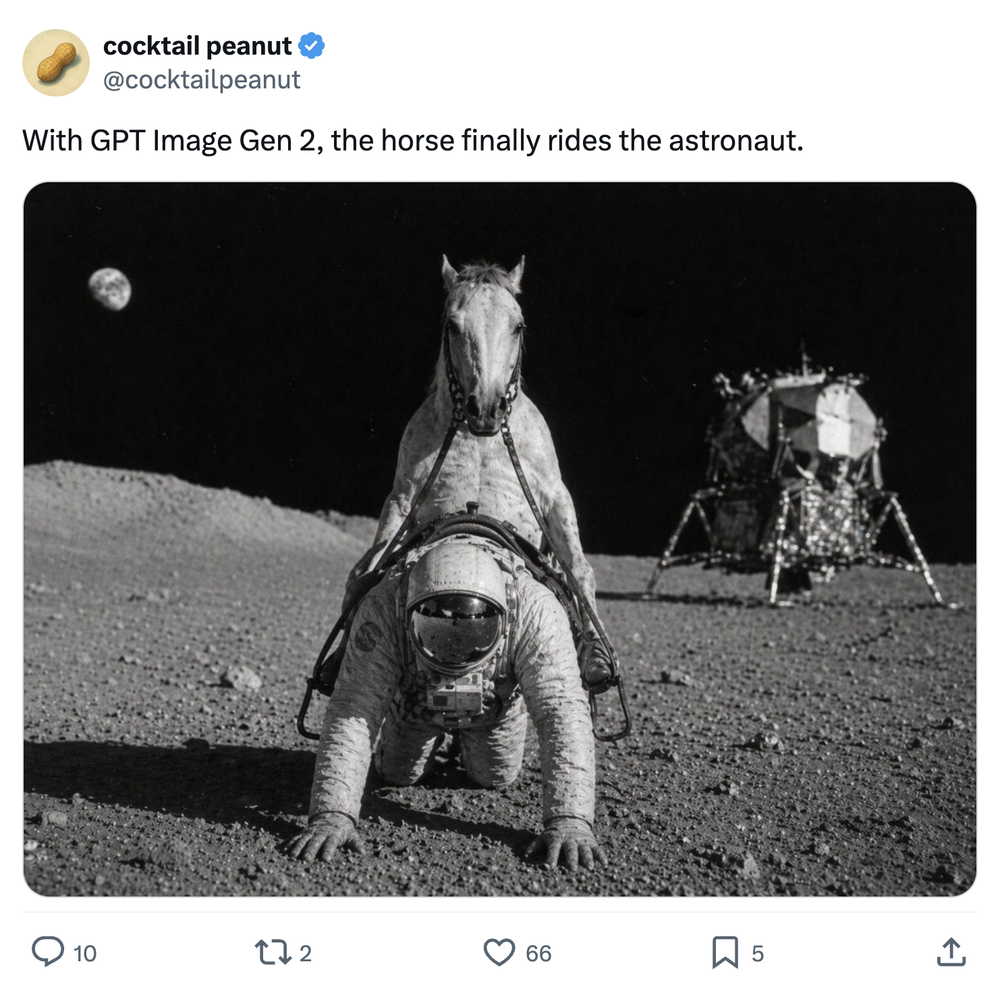

# MetaClean 🧼

> **Privacy-first image metadata, EXIF, GPS, and C2PA AI tag remover.**  
> Runs **100% locally** in your browser or from your terminal — no server, no uploads, zero tracking.



---

## 🎯 Why MetaClean?

### 1. Remove "Made with AI" Badges on Social Media
Social media platforms (like X/Twitter, Instagram, Facebook) inspect images for embedded **C2PA / Content Authenticity** metadata and automatically slap a **"Made with AI"** badge on them.

| Before (Original AI Image) | After (Cleaned with MetaClean) |
| :---: | :---: |
|  |  |

MetaClean purges the cryptographic C2PA manifests, certificates, and signature blocks, returning a clean image.

### 2. Protect Your Physical Privacy & Location
Smartphone and digital camera photos embed sensitive data:
* **GPS coordinates** (home address, workplace, vacation locations)
* **Camera / phone serial numbers**
* **Exact timestamp and dates**
* **Device software and computer usernames**

MetaClean strips all of this before you publish images online.

---

## 🚀 Usage

### 🌐 In the Browser (Zero Install)
1. Clone this repository or download the files.
2. Double-click `index.html` in your browser.
3. Drag and drop any image.
4. Preview the detected metadata and click **Download Clean Image**.

👉 **[Click here to use the Live Web App](https://8aditya8.github.io/metaclean/)** (Hosted free on GitHub Pages)

### 💻 In the Terminal (CLI)

```bash
# Run directly with npx
npx metaclean ./image.png

# Specify output destination
npx metaclean ./image.png ./image-clean.png

# Convert format during cleaning
npx metaclean ./image.png --format webp

# Specify custom output path
npx metaclean ./image.png --output ./dist/clean.jpg
```

---

## 🛠️ Supported Formats & Behavior

* **Formats:** JPEG, PNG, and WebP (exported in their original format whenever possible).
* **PNG Sanitization:** Strips text chunks (`tEXt`, `zTXt`, `iTXt`), EXIF (`eXIf`), C2PA (`caBX`), and browser resolution markers (`pHYs`).
* **JPEG Sanitization:** Strips EXIF (APP1), XMP (APP1), IPTC (APP13 Photoshop), ICC Profile (APP2), and Comment blocks (`COM`).
* **WebP Sanitization:** Strips EXIF, XMP, and ICCP chunks.
* **Canvas Snapshot:** Animated formats (like animated GIFs/WebP) are flattened to a clean single frame snapshot.

---

## 🔬 How It Works Under The Hood

Rather than trying to find and delete individual metadata tags (which can miss newer tags or corrupt file headers), MetaClean uses **Pixel Re-encoding**:

1. **Pure Decoded Pixels:** The browser/Node engine decodes only raw visual RGB/RGBA pixels into memory.
2. **Clean Canvas Paint:** The raw pixels are painted onto a clean `<canvas>` surface with no file headers or metadata fields attached.
3. **Fresh Export:** The canvas encodes a brand new image file from scratch.
4. **Binary Polish:** An extra byte scan strips any browser-injected chunks (like PNG `pHYs`).

Because no original header bytes or metadata blocks are copied over, **100% of hidden tracking tags, camera information, and AI signatures are completely eliminated.**

---

## 📦 Project Structure

```text
metaclean/
├── index.html          # Standalone, single-page web application
├── metaclean.js        # Browser canvas re-encoding engine
├── metaclean-node.js   # Node.js Sharp-based image cleaning engine
├── bin/
│   └── metaclean.js    # CLI entry point (Node.js executable)
├── assets/             # Screenshots and documentation examples
├── icon.svg            # Project logo
├── package.json        # Node.js package & script configurations
├── .gitignore          # Git ignore rules for node_modules
└── README.md           # Documentation & guides
```

---

## 📄 License

MIT License. Free to use, fork, and distribute.
